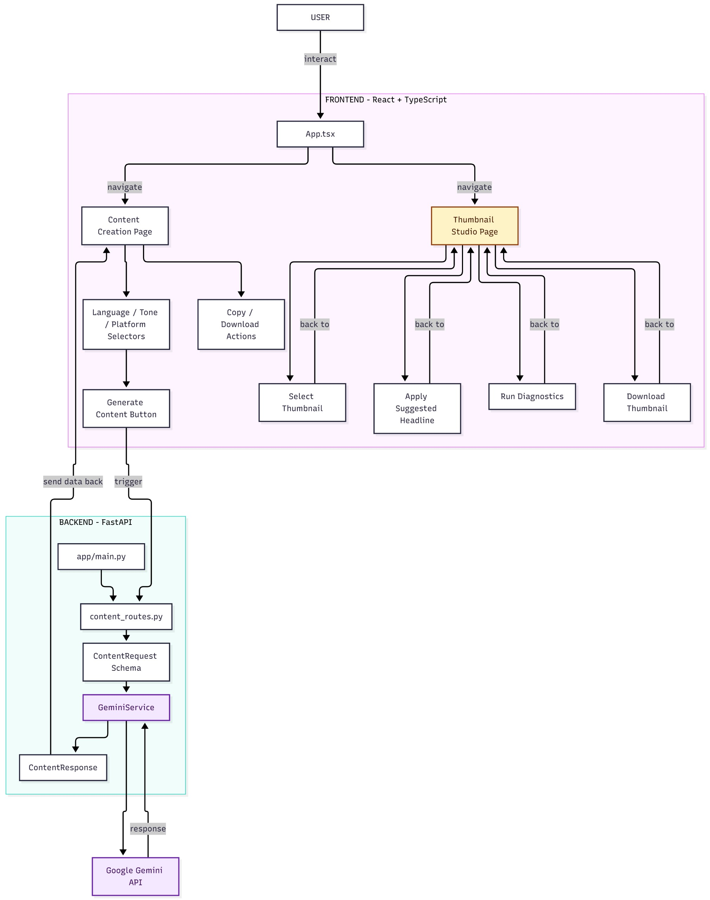

🚀 CreatorPilot AI

Your AI-Powered Multilingual Content Creation Assistant

CreatorPilot AI is an AI-powered content creation platform designed to simplify the content creation process for digital creators. It aims to transform ideas into engaging digital content using Generative AI, multimodal inputs, and multilingual support.

Our goal is to make content creation faster, smarter, and more accessible by bringing multiple AI-assisted content creation capabilities into one unified platform.

---

🎯 Problem Statement

Solo creators lose 60% of their creative hours wrestling with thumbnail variations, multi-platform cutdowns, semantic tagging, and engagement analytics.

Content creators often face challenges such as:

- Generating creative and engaging content ideas.
- Writing scripts, captions, and descriptions.
- Repurposing existing content for different platforms.
- Reaching audiences across multiple languages.
- Managing multiple content creation tools and workflows.
- Spending excessive time on repetitive creative tasks.

💡 Our Solution

CreatorPilot AI is designed as an intelligent, all-in-one content creation assistant that helps creators move from a simple idea to platform-ready content with the assistance of Generative AI.

Instead of depending on multiple disconnected tools for brainstorming, writing, content transformation, and language adaptation, creators can use a unified platform to simplify their workflow.

The platform integrates Google Gemini API to provide AI-powered assistance for understanding user inputs and generating relevant content.

How CreatorPilot AI Works

1. Multi-Modal Content Input

Creators can provide their content ideas or existing material through different input formats:

- Text Input: Enter a topic, idea, keyword, description, or creative brief.
- Audio Input: Provide voice-based ideas or recorded content for the intended audio-processing workflow.
- Video Input: Provide existing video content for the intended video-analysis and repurposing workflow.

This approach is designed to make content creation accessible regardless of how a creator prefers to express their ideas.

2. AI-Powered Understanding and Processing

The backend receives the submitted input and manages the content-processing workflow.

Google Gemini API is integrated to support intelligent content understanding and generation.

Depending on the input and requested task, the intended workflow can include:

- Understanding the creator's requirements.
- Identifying the main topic and context.
- Extracting relevant information.
- Processing creative instructions.
- Preparing suitable prompts for AI-generated content.

3. Intelligent Content Generation

Using Generative AI, CreatorPilot AI aims to assist creators in producing different types of content, such as:

- Engaging social media captions.
- Creative content descriptions.
- Video and short-form content scripts.
- Content ideas and suggestions.
- Platform-specific content variations.
- Relevant hashtags and keywords.

The generated content is intended to follow the creator's topic, instructions, and selected language.

4. Multilingual Content Assistance

Language should not become a barrier to creativity.

CreatorPilot AI aims to support content creation across multiple languages, allowing creators to generate or adapt content for audiences with different language preferences.

For example, a creator can start with an English content idea and generate an adapted version in Hindi or other supported languages.

5. Content Repurposing and Optimization

A single idea can be transformed into multiple content formats.

The planned workflow aims to help creators:

- Convert long-form ideas into short-form scripts.
- Create different caption variations.
- Adapt content for different social media platforms.
- Generate alternative titles and descriptions.
- Improve content presentation for different audiences.

6. Creator-Controlled Output

AI-generated content is presented for the creator to review, edit, and refine.

The creator remains in control of the final content instead of relying entirely on automated generation.

Key Value Proposition

CreatorPilot AI aims to bring the major stages of content creation into one intelligent workflow:

IDEA → INPUT → AI UNDERSTANDING → CONTENT GENERATION → LANGUAGE ADAPTATION → REVIEW → FINAL CONTENT

By combining multimodal input capabilities, Gemini-powered assistance, and multilingual content generation, CreatorPilot AI aims to reduce repetitive creative work and help creators focus more on originality, storytelling, and audience engagement.

Note: The above describes the intended product workflow. Audio/video processing, advanced repurposing, and several generation capabilities are still under development in the current MVP.

---

✨ Key Features

Current MVP Implementation

- Modern content creation user interface.
- FastAPI-based backend.
- Google Gemini API integration (partial).
- Backend API endpoints.
- Initial AI-assisted content-processing workflow.
- Interactive API documentation using Swagger UI.

Planned Capabilities

- Text, audio, and video-based content processing.
- Expanded multilingual content generation.
- Advanced content transformation.
- Personalized content recommendations.
- Social media content optimization.
- Content repurposing and format conversion.

Planned capabilities are not yet fully implemented.

🏗️ System Architecture
## 🏗️ System Architecture

🛠️ Tech Stack

Component| Technology
Frontend| Vite, TypeScript, react.js, Tailwind CSS, lucide React
Backend| Python, FastAPI, uvicorn
AI Integration| Google Gemini API, google GenAI SDK
API Documentation| Swagger UI
Version Control| Git, GitHub
Development Environment| Visual Studio Code, Swagger UI

⚙️ Installation & Setup

Prerequisites

- Python 3.10+
- Node.js and npm
- Git
- Google Gemini API key

1. Clone the Repository

git clone YOUR_GITHUB_REPOSITORY_URL
cd Creator-Pilot

2. Setup Frontend

npm install
npm run dev

3. Setup Backend

Open another terminal:

cd creatorpilot-backend

Create and activate a virtual environment:

python -m venv venv

Windows:

venv\Scripts\activate

Install dependencies:

pip install -r requirements.txt

4. Configure Environment Variables

Create a ".env" file inside "creatorpilot-backend" and configure the required Gemini API credentials.

Example:

GEMINI_API_KEY=your_api_key_here

5. Run Backend

uvicorn app.main:app --reload --port 8000

6. Access the Application

- Frontend: Use the local URL displayed by Vite.
- Backend API: "http://127.0.0.1:8000"
- Swagger Documentation: "http://127.0.0.1:8000/docs"

📊 Development Status

Current Stage: Partial Functional MVP

Module| Status
Frontend UI| Developed
FastAPI Backend| Partially implemented
Gemini Integration| Partially implemented
API Endpoints| Initial implementation
Multimodal Processing| Under development
Advanced Multilingual Generation| Planned
Content Repurposing| Planned

🔮 Future Scope

- Advanced multimodal AI processing.
- Improved audio and video content generation.
- Expanded multilingual capabilities.
- AI-powered social media optimization.
- Automated content publishing.
- Personalized creator assistance.
- Content performance analytics.
- Platform-specific content recommendations.

👥 Team

Project: CreatorPilot AI

Team name: RUNTIME TERRORS
Team Members:

- Team Member 1 — [ANJALI JHA]
- Team Member 2 — [RAHUL VIJAY SETH]
- Team Member 3 — [SUMAN THAKUR]
- Team Member 4 — [AMAN KUMAR]

🌍 Our Vision

We envision a future where every content creator can leverage Generative AI to transform simple ideas into impactful digital content without technical or language barriers.

CreatorPilot AI — Turn Ideas Into Impact.

---

Developed as an AI-powered innovation project.